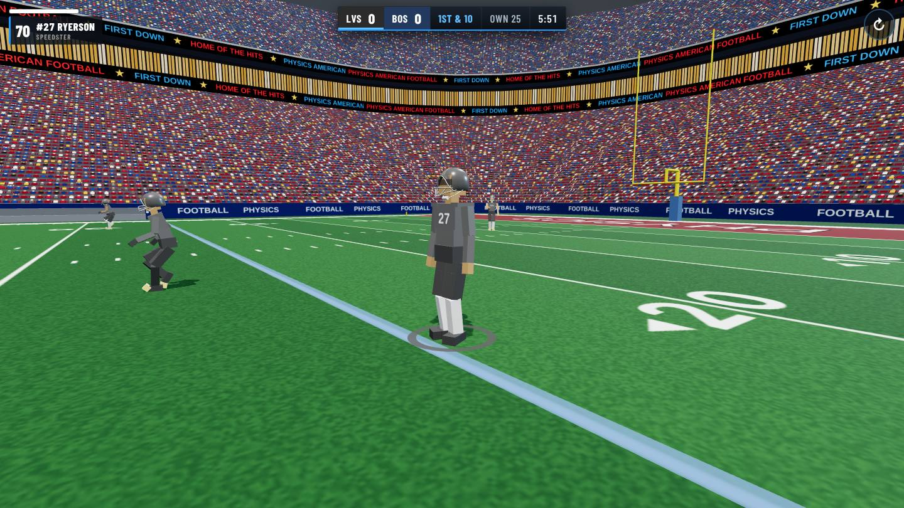
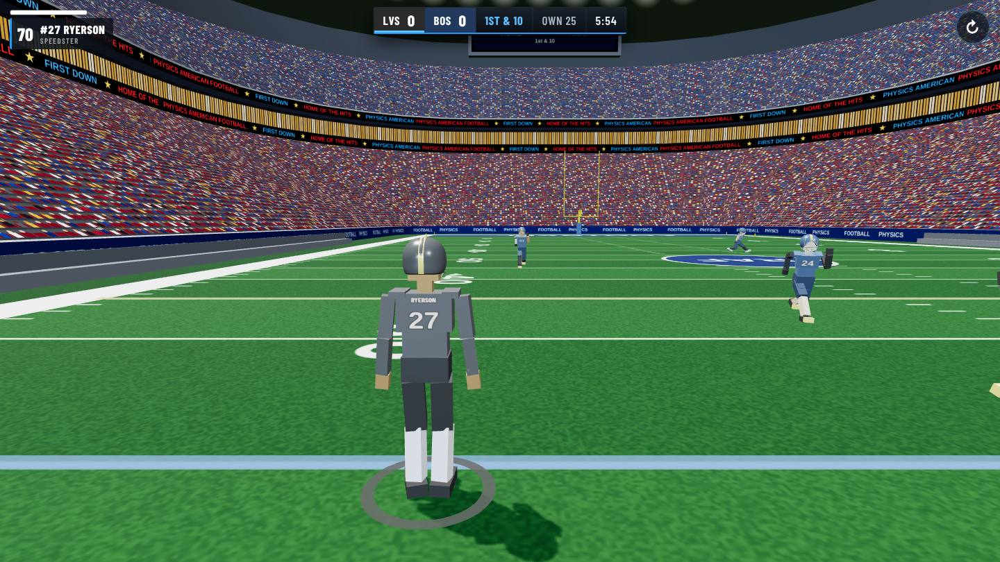
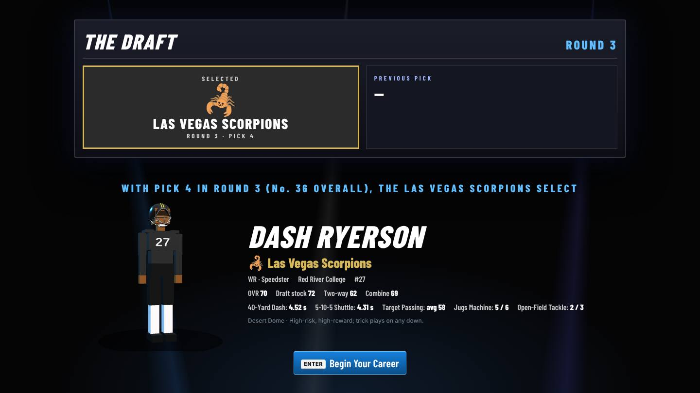
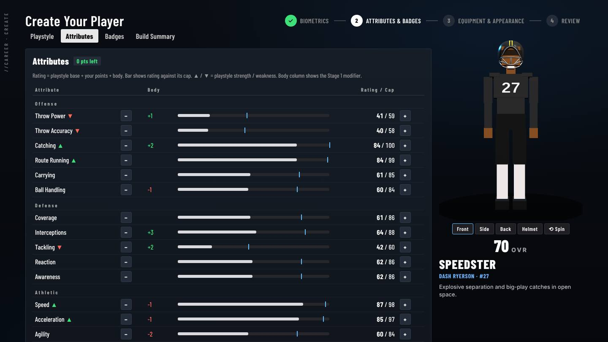
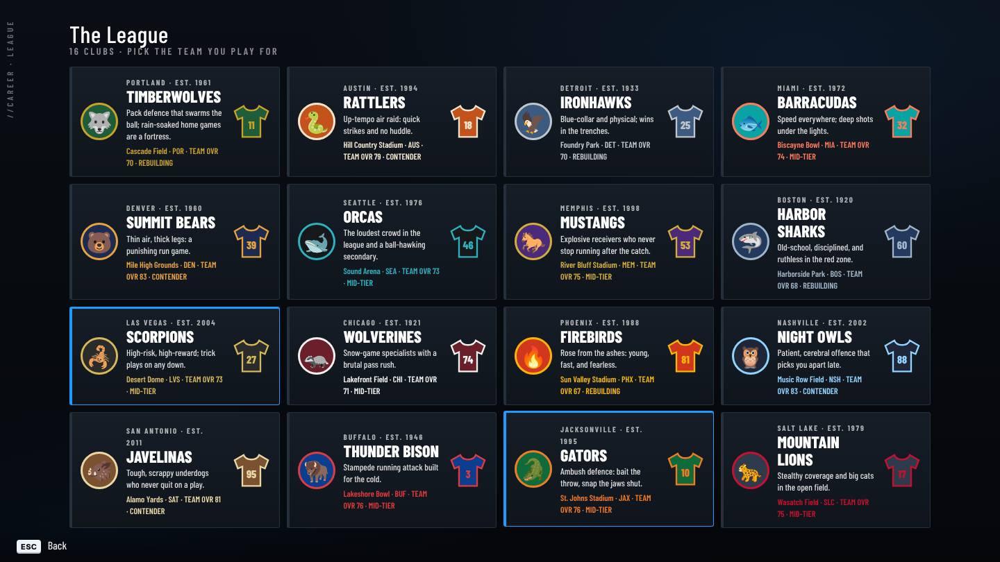

# PHYSICS AMERICAN FOOTBALL

**4v4 American football where every player is a physics-driven ragdoll.** 
Free in your browser · keyboard & mouse or touch · no download

### [▶&nbsp;&nbsp;PLAY NOW](https://dashryerson-design.github.io/Ragdoll-American-Footbal/play/)&nbsp;&nbsp;·&nbsp;&nbsp;[🌐&nbsp;&nbsp;Visit the website](https://dashryerson-design.github.io/Ragdoll-American-Footbal/)

---

<table>
<tr>
<td width="50%"></td>
<td width="50%"></td>
</tr>
<tr>
<td width="50%"></td>
<td width="50%"></td>
</tr>
</table>

- **Real physics:** tackles, broken tackles, fumbles, catches and falls are all simulated, not canned animations.
- **Quick Play:** jump straight onto the field and set up both teams from the pause menu.
- **Career Mode:** create a player built to true scale, run the combine, get drafted by one of 16 clubs, then play 20-week seasons and the playoffs, with trades and player development between seasons.

## Repository layout
| Path | What it is |
|---|---|
| `index.html` | The website (landing page) |
| `play/index.html` | The game: one file; three.js and cannon.js load from cdnjs |
| `assets/` | Screenshots captured from the game |

Career saves are kept in your browser (localStorage) for this site.
